# Modgeom - Tinymesh
## Introduction
### context
This is a fork of [tinymesh](https://github.com/eric-galin/TinyMesh) by eric galin.  
It was made as a class project for the ID3D M2 ModGeom class of year 2026-2027.  
This README serves as the handout, and mostly contains information relevant to this class.  
### AI disclosure
In the parts that were modified from the original TinyMesh, some of it was by me, some of it was done using free AI tools (Mimo2.6 on openCode, to be precise, i don't have the money for more). This is neither an endorsement nor a publicity for these tools, and would've rather done everything myself if i had the time to.  

As for the places AI was used, I must state that AI was used ONLY to create, update and fix parts related to QT and the graph editor specifically, and I did my best to keep its code relatively clean, undestandable, reusable and extensible by using existing libraries (in this case [QtNodes](https://github.com/paceholder/nodeeditor)). I explicitely prevented it from modifying any of the files in `Include/implicits` and from reading and writing to `Source/implicits`, or else it wouldn't make any sense to do this work from a learning standpoint.

### Graph interface
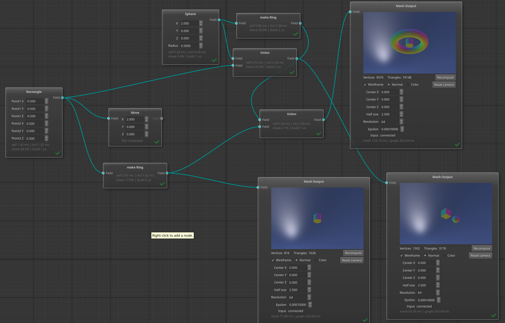  

The Interface has been rewworked to allow me to iterate more quickly without having to modify the main function and recompile when i wanted to try a new shape. This way, any existing code can be turned into a node, which can then be used alongside other nodes to form shapes, and check quickly that it works in different scenarios.  
The mesh output node is the final node of a graph, it takes a signed field as input, and shows a render of the 3D poligonization of that field at O. Each mesh output node can be computed independently by clicking on its recompute button. the camera can also be rotated by using ctrl+left click. to unlock more movement options, one can double-click on the preview of that node to open a bigger rendered window of the shape, with the same controls as TinyMesh.
All the other nodes wil be detailled in their own section later in this document.  
The graph also gives an estimation of the computation time by sampling 4096 pseudorandom points using a fixed seed. This gives an estimation of the cost of each node, which is detailed as follows:
 - self: the time that this node took to compute (the total time - children time)
 - incl: the inclusive time, how much time this, and all the previous nodes took to compute
 - share: the share of the computation that this node holds among all the nodes in the graph
 - build: how long it took to turn this graph node into an actual object (mostly interesting for the blobField node)

 and then, there are also some times that are specific to the mesh output node:
 - mesh: the time it took to poligonize the mesh
 - graph: the time it took to benchmark the entire node graph

 note the the graph time and the bencmarking only occur when clicking the top-left `[Recompute]` button, the benchmarking does not occur otherwise.

### Code 
the code is split into 3 parts:
- the top level code in `/Source` and `/Include` is the base Tinymesh source code. I tried to mostly keep-it as-is, so the modifications can give an idea of how the code works.
- the code in `/Source/implicits` and `/Include/implicits` is the hand-written implicit code. All classes there are superclasses of `AbstractScalarField` so the already implemented marching cubes algorithm just works
- the code in `/Source/nodes` and `/Include/nodes` is all the code needed to make the graph system work. The interesting parts if you want to add nodes are in `ImplicitNodeModels.h` and `ImplicitNodeModels.cpp`.

## SDFs
we implemented a few different field generators and operators:
### Generators
#### Sphere
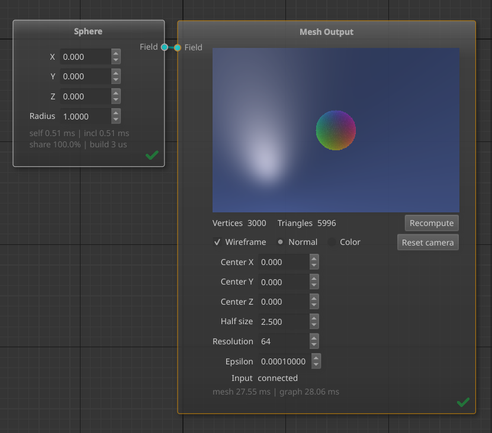  

as you can see, this very basic node just gives a distance from a point minus a radius. this is the most basic SDF one can have, and as you can see in the image, it takes less than a millisecond to compute.

#### Rectangle
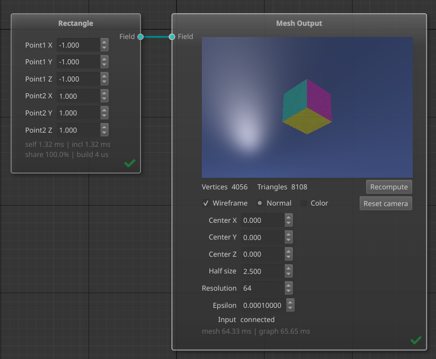  

this is the second node I added, it is a simple rectangle generator.  
I tried to make it a real distance field though, and if you use the threshold node (explained later) to enlarge its visualization, you do get a valid distance to the closest point on the rectangle, showing as a rectangle with rounded corners:  

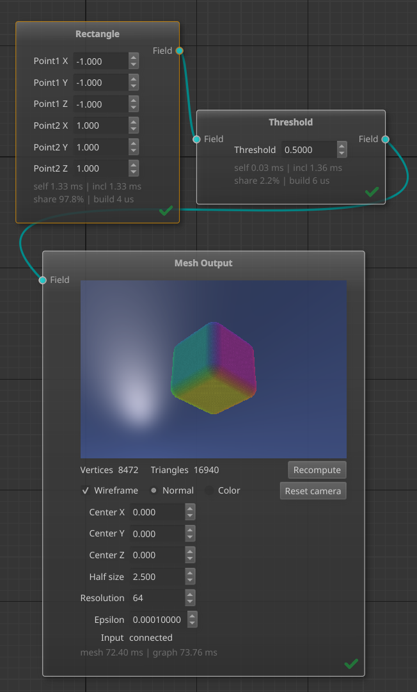

#### Torus
After a lot of thinking, it sounded better to have the torus be an operator. See Makering.

#### Pills/Capsules
Technically not implemented yet, but can still be done with a bit of creativity:  

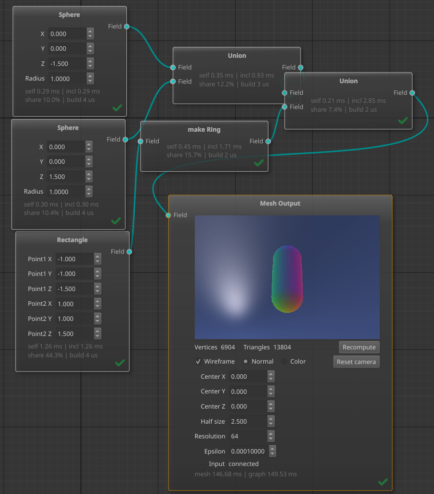

Of course, this is very slow and impractical (though it is a valid SDF), and I will come up with a proper implementation if I have the time to.

### Operators
#### Union
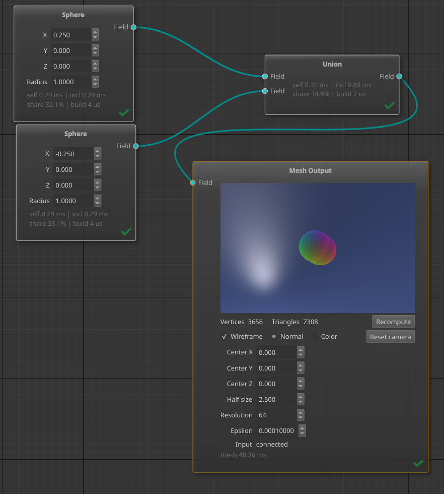  

the union node does exactly what you expect it to do, it merges two SDF by taking the minimum of the two values (and the according gradient/normal). It is also very fast (sub-ms per call on my computer)
#### Intersection
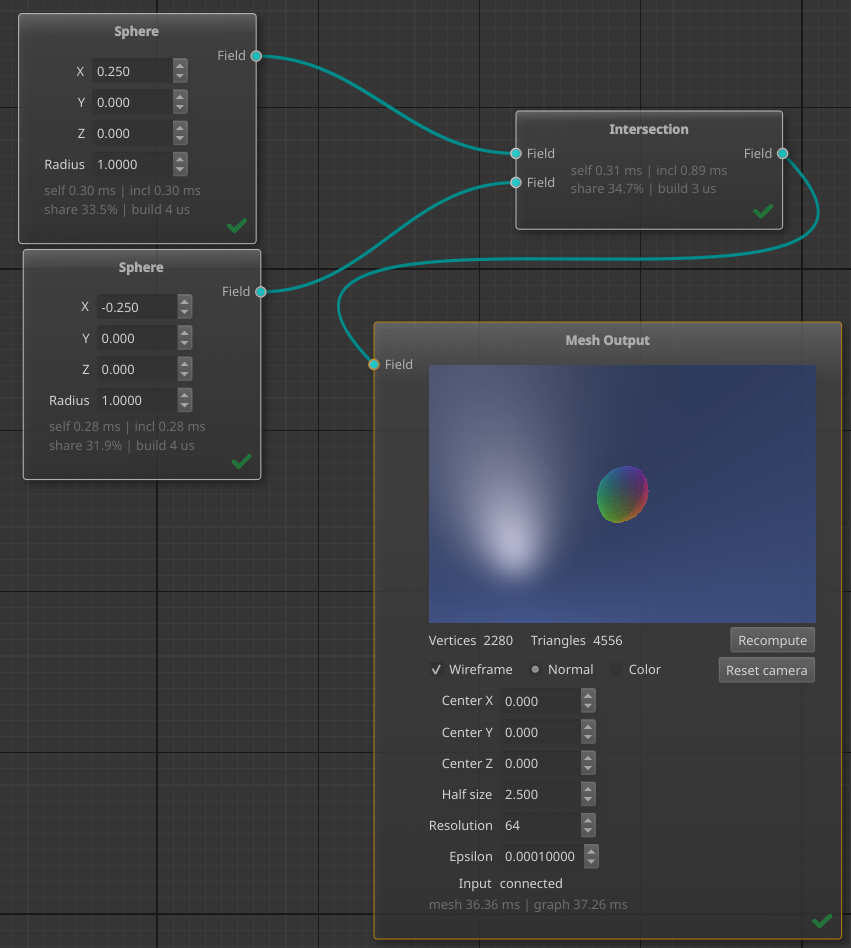  

the intersection node also does exactly what you'd expect by returning the maximum of the values given by the two SDFs, and the according gradient and normals. It is just as fast as the union.

#### Move
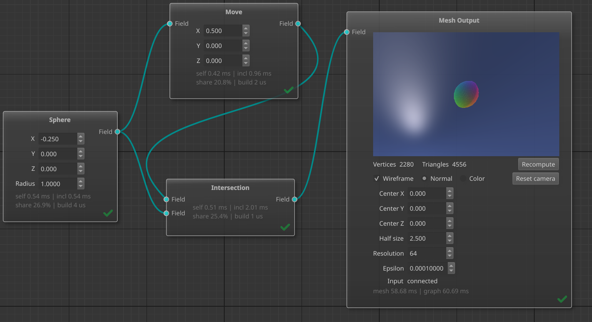  

this is a very simple node that moves the field (by moving the sampled point in the opposite direction). It leaves the normal and gradient untouched.  
its usefulness might not look obvious, but combined with the rotate node, it allows for quite powerful things.

#### Rotate
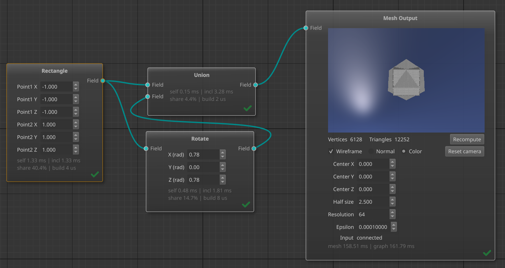  
This was arguably one of the hardest nodes to create. It creates a static rotation operator that creates an XYZ rotation matrix (and its inverse) on initialization. then, for each call, it rotates the sampled point around 0 (if you want to rotate around another point, use the move operator!) then returns its value. Or, in the case of the gradient or normal, it inverts the rotation of the returned vector before returning it.  

obviousely, these operations would've worked much better with the optimizations of BLAS or LAPACK, but we are using our own implementation of the vectors. In the end, i think the result is remarkably fast considering its lack of proper vectorization. (still sub-ms on my laptop)

#### Ringify
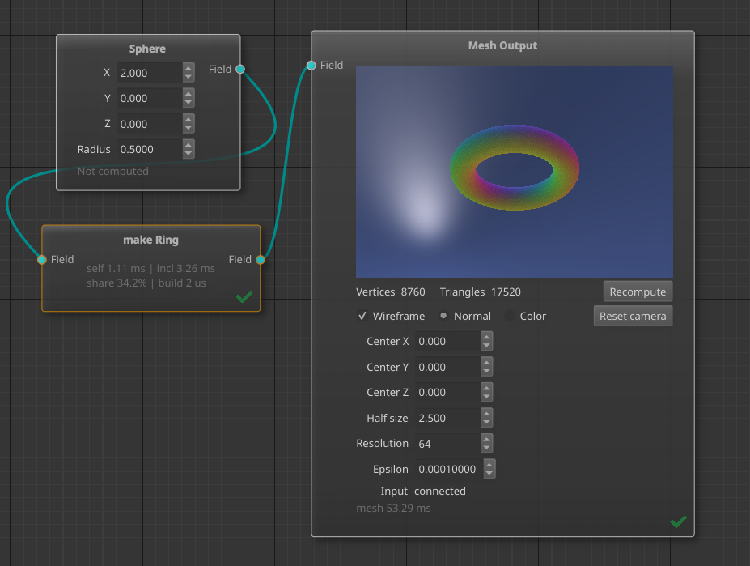  

as stated earlier, we did not create a proper torus node. The best version of a torus node we could come up with was a 2D SDF of a circle rotated in 3D around an axis.  
So we decided that instead of implementing a single-use torus node with a circle, we would let the user choose their SDF of choice instead. Hence the rigify node, which takes the (X>0, Y=0, Z=0) semiplane as a slice of the input field, then rotates it around the Z axis. An this would come at barely no added cost compared to a base torus implementation.  

this means that yes, you can make a rectangular torus. Or, if you let the a rectangle in the center of the field, you can make a valid cylinder SDF.  
I.E.  

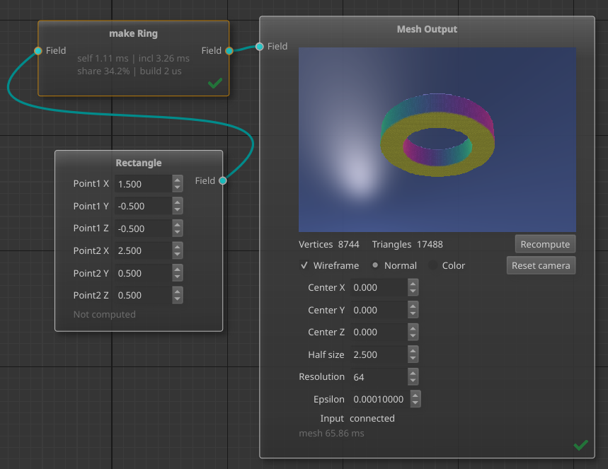  

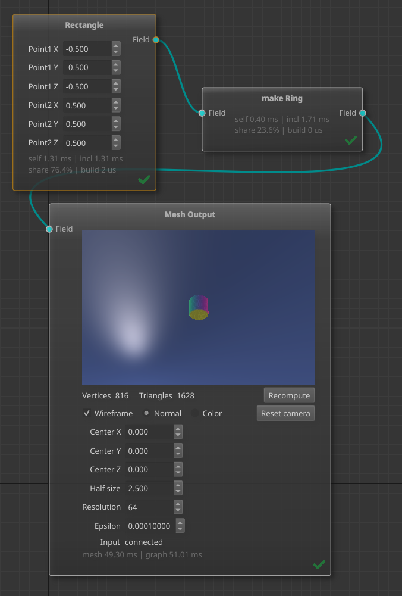  

## Blobs
### Nodal setup
there are multiple nodes required to make a blob field, and creating one requires a little bit of set up. We'll start with the basics:
#### The Blob node
by itself the blob node does nothing. the field it creates is a normal-looking bell field, which is >0 (or<=0 if you set its peak to a negative value). You can also set its position and radius, though the radius isn't guaranteed to be exact (it will depend on the threshold, see next subsection)  

There are muliple blob types that can be used interchangably. Just see the following lines at the beginning of `blob.cpp`:
```cpp
#define NORMAL		-1
#define HERMITE		0
#define POLYNOMIAL	1
#define WYVILL		4	// wyvill is defined to be the wtvill constant as well

#define CURRENT		POLYNOMIAL
```
to change the blob type, just set CURRENT to any of the above types.  
If you want to change the Wyvill N component, just define WYVILL to any value ⩾ 2 (here it is defined at 4).

#### Threshold
this is the node that allows us to see our blob field. given that our blobs are strictly positive or negative, we need to substract a small value to turn them into a signed field. This is what this node does, it will just substract the value at the sampled point by a given amount. This makes it also usable with SDFs (see our example for the rectangle node), and make our blof field usable with SDFs as well (though using blobs means that our SDFs will remove the exactitude of the distances in our signed **distance** field).  

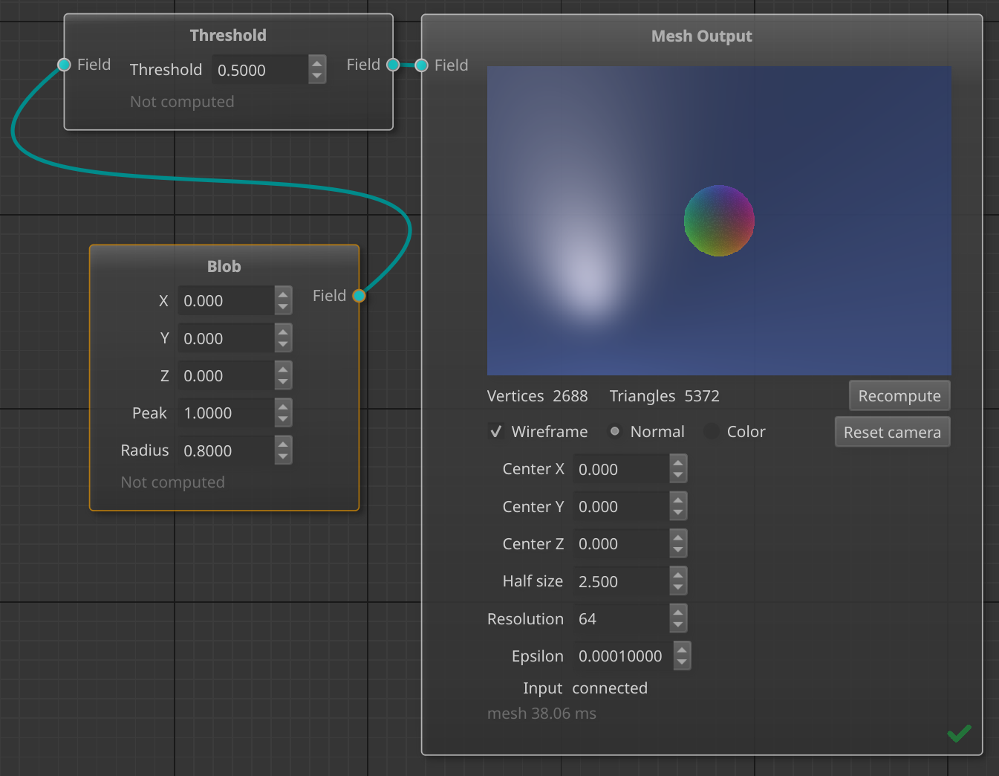  
#### ImplicitAdd
Our blob field wouldn't be very interesting if it only had one blob.  
So We need the ImplicitAdd node to add them all together.

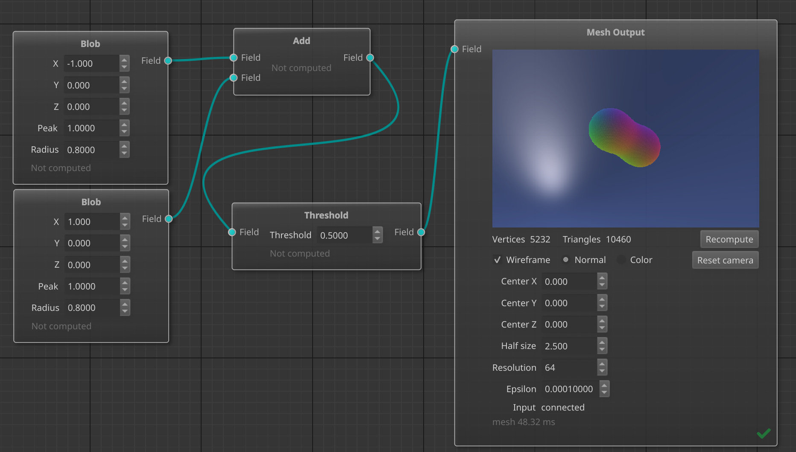  

in order for it to work properly, we need to also add the gradients together. and since we will only get the normal from the latest node, we set the normal to be the inverse of the add's own gradient. This way, the normal are correct even in the Signed implicit space.

##### Blobfield
Adding all these blobs and adds by hand takes a lot of work. So We added a blobfield node that shows a list of blobs as a table and automatically balances them in a tree where nodes are adds and leaves are blobs. This also makes it a bit easier to import big blob fields (more on that in the next section)  
Here you can see a blob field made out of 100 blobs (some of which hold negative values)  

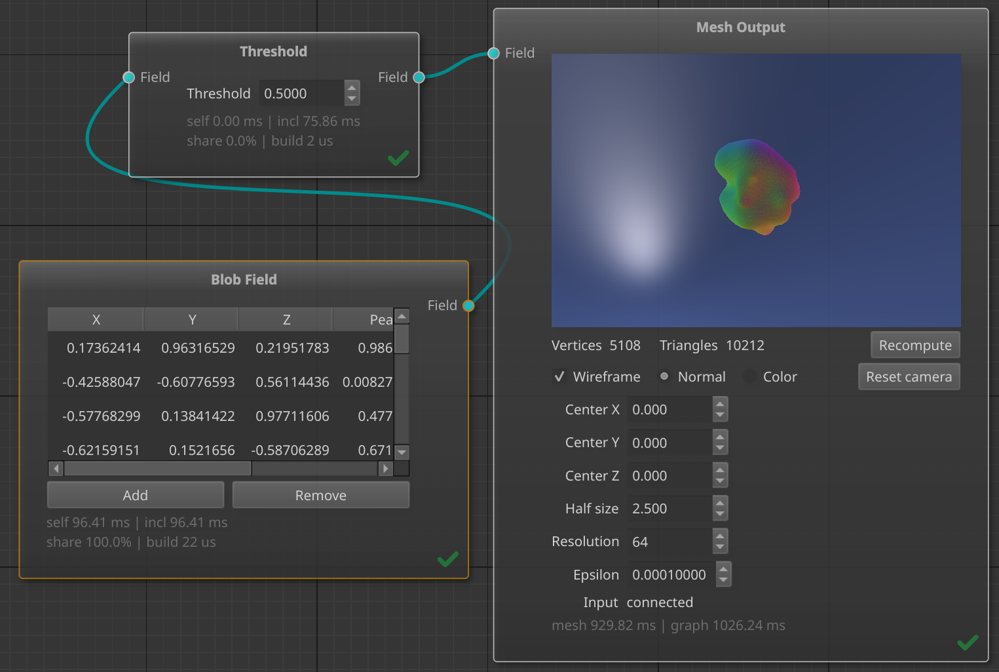

### technical points
There are multiple ways to create blobs, we tried all the ones we saw in class, as well as a gaussian blob, just to see what could be done.

each of these will be thouroughly benchmarked in this chapeter.

#### Benchmarking setup
the benchmarks on blobs were done using the BlobField node. The blobField node has two modes: List and Tree. The list mode was created by tricking tree mode into using something akin to a linked list. it can be enabled or disabled in `Source/implicits/blobField.cpp` by defining `LINEAR` or not defining it. we will benchmark against both to get a better overview of the impact of a properly balanced tree on performance.  

The blob fields were generated using the following python script (modified with different variables for each run):
```python
from random import *
for i in range(10000): # number of samples to generate
    print("                    {")
    print(f"                        \"peak\": {uniform(-1, 1)},")	# which peaks to use
    print(f"                        \"radius\": {uniform(0.01, 0.3)},") # which radiuses to use
    print(f"                        \"x\": {uniform(-1, 1)},") # choose positions withing the marching cubes box.
    print(f"                        \"y\": {uniform(-1, 1)},")
    print(f"                        \"z\": {uniform(-1, 1)}")
    print("                    },")
```  

this outputs JSON that can then be used to replace the contents of the blobfield node in the `blobfield.flow` file. The files edited with various generations are stored in the `samples` folder. we will be using `blobfield10.flow`, `blobfield100.flow`, `blobfield1000.flow` and  `blobfield10000.flow` as the base for out benchmmark. we will use the graph time in milliseconds as reported by the software on the recompute of the entire pass.  

here are the results:
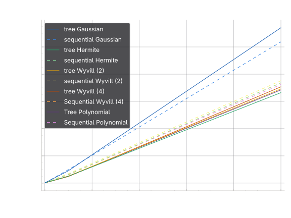  

| number of blobs | tree gaussian | sequential gaussian | tree hermite | sequential hermite | tree wyvill 2 | sequential wyvill 2 | tree wyvill 4 | sequential wyvill 4 | tree polynomial | sequential polynomial |
|---|---|---|---|---|---|---|---|---|---|---|
10 | 239.16 | 249.31 | 105.11 | 88.01 | 151.05 | 87.80 | 93.42 | 84.13 | 93.80 | 85.94
100 | 1023.12 | 1057.56 | 666.94 | 820.81 | 655.60 | 861.96 | 645.07 | 786.17 | 667.35 | 828.51
1000 | 9133.07 | 9913.04 | 5073.73 | 6405.92 | 5185.29 | 6958.02 | 4857.45 | 6127.58 | 5066.18 | 6410.62
10000 | 114110.68 | 103744.97 | 66442.23 | 73684.63 | 69191.68 | 75203.72 | 70725.68 | 73617.84 | 68463.94 | 72383.20

here are different renders of the same 10000 blobs:  

| gaussian | hermite | wyvill 2 | wyvill 4 | polynomial
|---|---|---|---|---|
|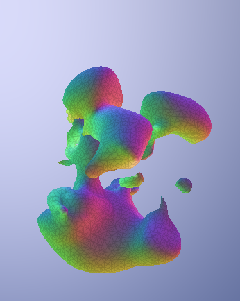|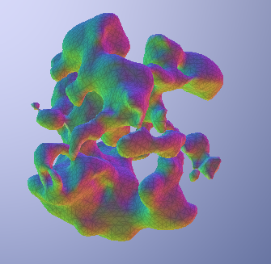|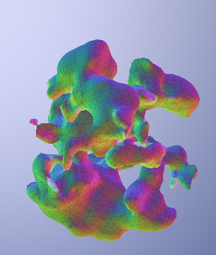|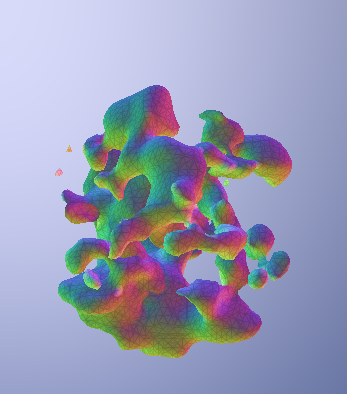|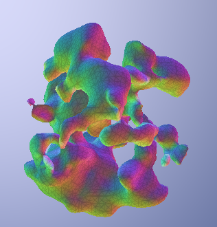|

I personally really like the soft look of gaussian blobs, but the other types are much easier to work with, on top of being much faster.  

One interesting property we can see is that except for gaussians, all tree-based computations are slightly faster than their sequential counterparts. The best theory I can come up with as to why this is the case, is that in bounded trees, the many cases in which the function returns 0 means that the leaves will be easier to compute, with no floating point additions required when the value is already 0.  
On the other hand, gaussians are faster when computed linearly, because they are never 0, and as such, the non-terminal recursion adds a little bit of overhead and stack calls, causing the function to perform less well.  
Though, all of this is just a theory and would require deeper investigations to properly assess the causes.  

In the end, If what you are after is performance,then the Tree based hermite blob should give you the fastest result (and should be even faster with some proper threading). Otherwise, it is mostly up to the artistic vision.


## Windows
- First, you must install Qt6 (https://www.qt.io/download, use the open source version). Install the msvc2019_64 compiler only (*Note: other compilers can work too*).
- Set the "QTDIR64" environment variable to your Qt installation folder (example: "E:\Code\Qt\6.3.0\msvc2019_64")
- Set the "GLEW_DIR" environment variable to the path "XXX/TinyMesh/Libs/", with XXX the path to your repository.
- Run the script TinyMesh/Script/AppTinyMeshDeploy.bat

Finally, open the Visual Studio solution files with Visual Studio 2022 Community, or open the QtCreatorProject.pro with QtCreator. Compile/Build and execute, everything should work.
*Note: For other IDE, you will have to use the provided CMakeLists.txt to generate the solution files yourself.*

## Linux
- First, you must install Qt6 (https://www.qt.io/download, use the open source version). Install the gcc compiler only (*Note: other compilers can work too*).
- Install the following packages
```
sudo apt-get install g++ libglew-dev freeglut3-dev
```
Finally, open the QtCreatorProject.pro with QtCreator. Click on configure, then build and execute, everything should work.
*Note: For other IDE, you will have to use the provided CMakeLists.txt to generate the solution files yourself.*

## Mac OS/X
- First, you must install Qt6 (https://www.qt.io/download, use the open source version). Install the gcc compiler only (*Note: other compilers can work too*).
-  Install the following packages (*Note: Depending on your Mac OS/X version, other packages might be needed. Shoot me an email if anything is missing.*
```
brew install glew
```
Finally, open the QtCreatorProject.pro with QtCreator. Click on configure, then build and execute, everything should work.
*Note: For other IDE, you will have to use the provided CMakeLists.txt to generate the solution files yourself.*

## Additional notes
Optionally, you can use your own code (without Qt) to do the windowing and rendering part. In this case, you can extract the following files, which don't have any dependencies apart from the C++ standard library:
 - box.h/.cpp
 - camera.h/.cpp
 - color.h
 - implicits.h/.cpp
 - mathematics.h
 - mesh.h/.cpp (*You must remove the Mesh::LoadObj and Mesh::SaveObj functions, which depends on Qt*)
 - meshcolor.h/.cpp
 - ray.h/.cpp
